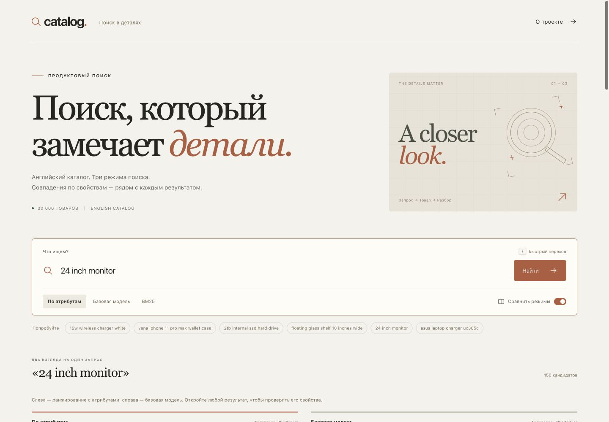
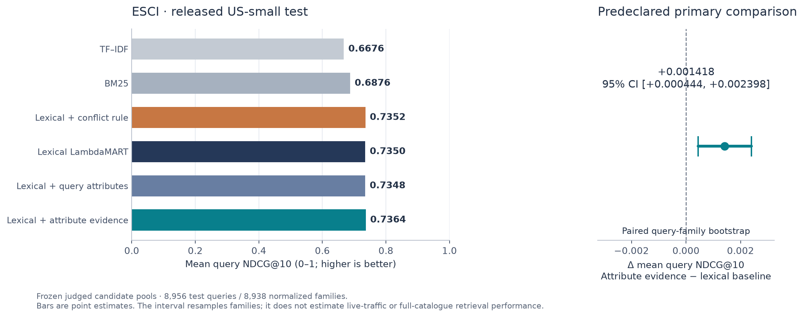

# Catalog Search

[](https://github.com/NikkiRe/catalog-search/actions/workflows/check.yml)

Product search with explicit evidence about **size, power, capacity and model**.
BM25 retrieves candidates; LightGBM LambdaRank reranks them. The browser compares
three search modes and shows which requested properties match, conflict or lack
enough evidence in the product text.

Classical ML, CPU inference, historical English catalog. No external inference API.

On 8,956 released ESCI test queries, NDCG@10 is **0.7364**, versus **0.6876**
for BM25 and **0.7350** for the strong lexical ranker. The additional attribute
effect is small: **+0.00142**, with a paired 95% interval **[+0.00044, +0.00240]**.
The frozen WANDS transfer test did not establish an additional attribute benefit.



## Run the application

Python **3.12** and [uv](https://docs.astral.sh/uv/) are required. On Linux,
LightGBM needs OpenMP (`apt-get install libgomp1`); macOS may need `brew install libomp`.

```bash
git clone https://github.com/NikkiRe/catalog-search.git
cd catalog-search
uv sync --locked --no-editable
uv run --no-sync python scripts/download_demo.py
uv run --no-sync catalog-search serve
```

Open **http://127.0.0.1:8765**. The verified release supplies trained models,
the fitted encoder and a 30,000-product demonstration index. Dataset text and
models are downloaded once; inference then runs offline. The bundle's checksum
is pinned in `scripts/demo_release.json`. Joblib artifacts use pickle: use this
verified release or your own training output.

If you unpacked the ready-to-run project archive with an `artifacts/` folder,
skip the download command. The separate release ZIP contains runtime artifacts;
the source repository contains their documentation and complete evaluation files.

Alternatively open the repository in GitHub Codespaces. Its dev container installs
the package and bundle; run `uv run --no-sync catalog-search serve --host 0.0.0.0`
and open port 8765.
A Dockerfile is also included.

```bash
uv run --no-sync catalog-search search '24 inch monitor' --mode attribute --limit 5
```

## What is tested

The primary experiment reranks **181,701 judged candidates for 8,956 released ESCI
test queries**. Numeric query families stay together; 80 overlapping official-train
queries are removed, while every official-test query remains. Vocabulary and IDF
use 303,198 unique training products. Development selects between two tree sizes
per learned variant before final train+development fitting and test evaluation.

The comparison includes BM25, TF–IDF, a 28-feature lexical ranker, that ranker plus
a fixed conflict-demotion rule, the 58-feature attribute ranker, and a query-only
attribute ablation. The lexical reference receives the same title, brand,
description and bullet point text as the attribute model.

About 47.8% of prepared products have no description and 13.2% have no bullet
points. Missing specifications therefore produce `unknown`, not a mismatch.
Field missingness, label counts and candidate-list sizes are saved in
[`reports/data_audit.json`](reports/data_audit.json).

The primary metric uses **E=1, S=.1, C=.01, I=0**, query-mean NDCG@10 and a paired
5,000-resample interval by normalized query family. WANDS is held out for frozen
external transfer: 480 queries and 231,859 consensus query-product pairs. Partial
labels use separately declared sensitivity maps; 14 contradictory pairs have a
preserved ambiguity ledger and min/max scenarios.

Read the [measured results](reports/results.md),
[machine-readable report](reports/summary.json),
[evaluation protocol](docs/evaluation_protocol.md) and
[attribute contract](docs/attribute_contract.md).
The application also has an experiment page backed by the same saved report.



[See the actual side-by-side search](docs/figures/search-comparison.png).

**Scope:** these scores measure reranking inside judged pools. They do not measure
full-catalog retrieval recall, purchases or compatibility safety. Attribute
evidence is a conservative text comparison, not a relevance probability or a
causal explanation of a tree score. Family grouping is a heuristic against
simple numeric-template leakage, not semantic deduplication of every query.

## Reproduce the experiment

Download size is about 1.2 GB for ESCI plus 97 MB for WANDS. Feature generation
uses substantially more RAM than serving the 30,000-product demo; the recorded
run used an Apple Silicon laptop with 24 GB RAM and six training threads.

```bash
uv sync --locked --extra dev --no-editable
uv run --no-sync catalog-search download --output data/esci_raw
uv run --no-sync catalog-search prepare --raw data/esci_raw --output data/esci \
  --config configs/experiment.json
uv run --no-sync python scripts/prepare_wands.py --output-dir data/wands \
  --revision 3b74dcf4ba29ab8ff3e6a50b5b09fc627cb882b5
uv run --no-sync catalog-search train --data data/esci --wands data/wands \
  --output runs/reproduction/artifacts --config configs/experiment.json
uv run --no-sync python scripts/build_demo.py --data data/esci \
  --artifacts runs/reproduction/artifacts
```

Use a new output directory for a new run. Existing protocol/selection/results
files are refused. Raw data and generated models are excluded from Git.
The saved protocol records source, configuration and partition hashes; selected
tree counts are sealed before test inference. Finite seeded bootstrap output is
deterministic. Small model differences across library/platform builds remain
possible; dependency versions and the original model files are retained.

To serve the models produced by this reproduction rather than the downloaded
demo bundle:

```bash
uv run --no-sync catalog-search serve --artifacts runs/reproduction/artifacts
```

## Inspect and verify

```bash
uv run --no-sync pytest -q
uv build
```

After downloading the bundle, `uv run --no-sync python scripts/verify_demo.py`
checks real searches, product lookup, HTTP endpoints and the experiment report.
`scripts/benchmark.py` records sequential warm-engine timings on the six declared
demo queries; its timings exclude HTTP and are not a production traffic test.

- `src/catalog_search/`: data checks, shared features, parser, metrics, experiment,
  search engine, HTTP API and CLI.
- `web/`: buildless interface, mode comparison, evidence drawer and experiment page.
- `reports/`: protocol, selection, scores, per-query metrics and result interpretation.
- `docs/design.md`: retrieval/ranking boundary, serving and artifact decisions.
- `docs/interview.md`: questions to explain using the actual code and results.
- `docs/references.md`: original papers, dataset releases and ranking documentation.

Project code: MIT. ESCI excerpt: Apache-2.0. WANDS: its MIT license.
See [third-party notices](THIRD_PARTY_NOTICES.md) and `licenses/`.
