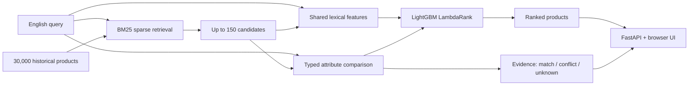

# Search design

The application separates candidate retrieval, learned ranking and evidence
display. The benchmark evaluates ranking on judged lists; the application searches
a smaller historical catalog. These are different evaluation scopes.

## Why both lexical and typed signals?

Word TF–IDF/BM25 handles exact terms, character TF–IDF handles spelling and model
fragments, and token/numeric overlaps form a stronger reference than plain BM25.
Both learned models use the same title, brand, shortened description and bullet
point text. The attribute model adds a representation; it does not secretly get
extra product metadata.

The deterministic parser recognizes explicit storage capacity, power, length,
supported model families and a small brand lexicon. It records spans and canonical
units and abstains when scope or intent is ambiguous. A missing field is not a
conflict. Different nominal charging wattages are not sufficient to establish
incompatibility. Model suffixes and accessory roles need separate treatment.
See the exact [attribute contract](attribute_contract.md).

Attribute evidence describes found text. It is not a causal explanation of every
tree's score, a relevance probability, a compatibility certificate or independent
ground truth. The learned ranker can keep a product with a conflict; it is not a
hard filter. A separately evaluated rule baseline demotes explicit conflicts.

## Training boundary

The encoder vocabulary, IDF and average document lengths are fitted on unique
training products. Development chooses between two tree sizes per learned
variant with the same iteration/early-stopping budget. Final tree counts are
fixed before training on train+development; the encoder stays unchanged.

The primary comparison is the all-query attribute-minus-lexical result. A
query-only attribute ablation distinguishes product comparison evidence from
the simpler benefit of telling a tree what kind of query it sees. No result is
guaranteed to be positive. WANDS is a frozen transfer test, with its separate
label convention declared before inference.

## Serving boundary

Models are loaded once. BM25 and all ranking modes share the same retrieved
candidate pool for a query. Explanations are computed from the same source text
as features. No remote model, account, external inference API or GPU is needed.
The interface has no invented offers, product images or customer reviews.

The default server binds to localhost. It does not persist query logs; HTTP
access logs are disabled by the CLI. The application is a portfolio demonstration,
not a multi-tenant service with authentication, rate limits or continuously
updated stock. Concurrent production serving would require resource limits,
load testing, a fresh catalog and relevance evaluation of retrieval.

## Reproducibility and artifact trust

Immutable source revisions, byte checksums, prepared partition hashes, source
hashes, configuration, vocabulary sizes, selected trees and query-level results
travel with the experiment. The public demo bundle is separately checksummed.
Joblib uses Python pickle: load only the author's verified release or artifacts
you produced yourself. Text LightGBM models alone do not make the encoder safe
to deserialize from an unknown third party.
