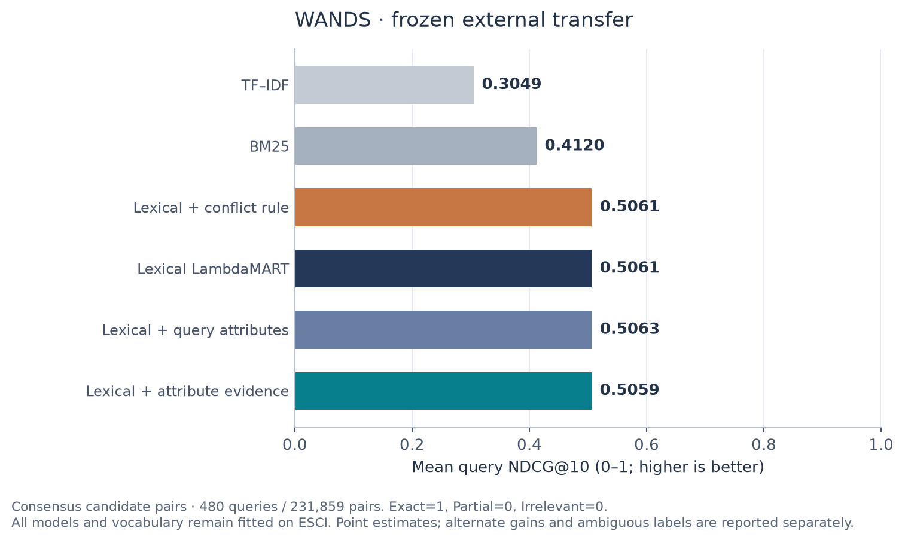

# Frozen ranking results

Completed 2026-10-26T12:29:45.455499+00:00. These results rerank the released judged candidate pools; they do not measure full-catalogue recall, conversion or business profit.

The predeclared primary comparison is attribute evidence versus lexical LambdaMART on every released ESCI US-small test query. Mean query NDCG@10 is **0.7364 versus 0.7350**: an absolute difference of **+0.001418**, or **+0.19%** relative to the baseline. The 95% paired normalized-query-family interval is **[+0.000444, +0.002398]**. The paired interval lies above zero: the primary comparison favors attribute evidence on this evaluated cohort.

The interval uses 5,000 seeded percentile bootstrap replicates over 8,938 normalized families (8,956 queries), retaining all queries in each resampled family. It is conditional on this released cohort, its judgments and the heuristic grouping; it does not establish robustness across time or representative user traffic.

## ESCI comparison

| Model | NDCG@10 | NDCG all | Exact Recall@10 | Exact MRR | Δ NDCG@10 vs lexical |
| --- | --- | --- | --- | --- | --- |
| TF–IDF | 0.6676 | 0.8015 | 0.6467 | 0.7110 | -0.0674 |
| BM25 | 0.6876 | 0.8155 | 0.6568 | 0.7392 | -0.0474 |
| Lexical + conflict rule | 0.7352 | 0.8448 | 0.6957 | 0.7975 | +0.0002 |
| Lexical LambdaMART | 0.7350 | 0.8446 | 0.6959 | 0.7975 | +0.0000 |
| Lexical + query attributes | 0.7348 | 0.8445 | 0.6957 | 0.7971 | -0.0002 |
| Lexical + attribute evidence | 0.7364 | 0.8456 | 0.6967 | 0.7982 | +0.0014 |

All scores are query means. Exact Recall@10 averages only queries with an Exact item; MRR is zero when none exists. Zero-IDCG queries have NDCG zero. The conflict-rule comparator demotes parsed conflicts below other candidates while preserving lexical order; it is a deliberately simple alternative to learning from soft evidence.

## Query-only attribute diagnostic

The model with lexical features and query-only attribute counts reaches NDCG@10 **0.7348**. The full attribute model differs by **+0.0016**; the query-only model differs from lexical by **-0.0002**. Each variant received the same development search budget. These diagnostic point comparisons separate some query-type signal from product-evidence signal; they do not measure extraction precision or identify a causal mechanism.

## Predeclared descriptive slices

| Slice | Queries | Families | TF–IDF | BM25 | Lexical + conflict rule | Lexical LambdaMART | Lexical + query attributes | Lexical + attribute evidence |
| --- | --- | --- | --- | --- | --- | --- | --- | --- |
| attribute_mentioned | 606 | 602 | 0.6426 | 0.6640 | 0.7630 | 0.7602 | 0.7608 | 0.7693 |
| no_attribute_mentioned | 8,350 | 8,336 | 0.6694 | 0.6893 | 0.7332 | 0.7332 | 0.7330 | 0.7340 |
| all_candidates_new_to_final_fit | 1,507 | 1,506 | 0.7054 | 0.7212 | 0.7676 | 0.7678 | 0.7669 | 0.7672 |
| some_candidate_seen_in_final_fit | 7,449 | 7,432 | 0.6600 | 0.6808 | 0.7286 | 0.7284 | 0.7284 | 0.7302 |

These slices were specified before evaluation. They are descriptive, may overlap and have no multiple-comparison significance claim. “New to final fit” concerns all products in a query's candidate pool, not temporal cold start. Attribute-mentioned means a parser record was emitted, including ambiguous records; it is not a verified-constraint label.

## Descriptive metadata audit

Among 481,483 prepared products, 47.789% have an empty description, 5.642% an empty brand and 13.200% empty bullet/attribute text. These describe the fixed shortened metadata, not parser accuracy. Missing information supports an unknown status rather than a contradiction.

Training judged pools have median 16 candidates, 90th percentile 40 and maximum 188; the test maximum is 95. Pool-size variation and missing specifications are part of this evaluation, not additional controlled treatments.

## Frozen WANDS external evaluation

No vocabulary, ranker, parameters or thresholds were fitted or selected on WANDS. The primary external relevance map is Exact=1, Partial=0, Irrelevant=0. WANDS Partial is not mapped to ESCI Substitute. Alternative Partial gains and ambiguous annotation scenarios remain separate descriptive evaluations.

### consensus_main

480 queries, 480 normalized families, 231,859 judged pairs.

| Model | exact_binary | partial_0.1 | partial_0.5 |
| --- | --- | --- | --- |
| TF–IDF | 0.3049 | 0.5573 | 0.7305 |
| BM25 | 0.4120 | 0.6521 | 0.7912 |
| Lexical + conflict rule | 0.5061 | 0.7249 | 0.8276 |
| Lexical LambdaMART | 0.5061 | 0.7249 | 0.8276 |
| Lexical + query attributes | 0.5063 | 0.7254 | 0.8283 |
| Lexical + attribute evidence | 0.5059 | 0.7251 | 0.8284 |

| Gain map | Values | Attribute − lexical [95% CI] | Relative difference | Zero-IDCG queries |
| --- | --- | --- | --- | --- |
| exact_binary | {"Exact": 1, "Irrelevant": 0, "Partial": 0} | -0.000143 [-0.004371, +0.003970] | -0.03% | 101 |
| partial_0.1 | {"Exact": 1.0, "Irrelevant": 0.0, "Partial": 0.1} | +0.000217 [-0.003619, +0.004030] | +0.03% | 1 |
| partial_0.5 | {"Exact": 1.0, "Irrelevant": 0.0, "Partial": 0.5} | +0.000840 [-0.001813, +0.003574] | +0.10% | 1 |

### ambiguous_min

480 queries, 480 normalized families, 231,873 judged pairs.

| Model | exact_binary | partial_0.1 | partial_0.5 |
| --- | --- | --- | --- |
| TF–IDF | 0.3049 | 0.5573 | 0.7305 |
| BM25 | 0.4120 | 0.6521 | 0.7912 |
| Lexical + conflict rule | 0.5061 | 0.7249 | 0.8276 |
| Lexical LambdaMART | 0.5061 | 0.7249 | 0.8276 |
| Lexical + query attributes | 0.5063 | 0.7254 | 0.8283 |
| Lexical + attribute evidence | 0.5059 | 0.7251 | 0.8284 |

| Gain map | Values | Attribute − lexical [95% CI] | Relative difference | Zero-IDCG queries |
| --- | --- | --- | --- | --- |
| exact_binary | {"Exact": 1, "Irrelevant": 0, "Partial": 0} | -0.000143 [-0.004371, +0.003970] | -0.03% | 101 |
| partial_0.1 | {"Exact": 1.0, "Irrelevant": 0.0, "Partial": 0.1} | +0.000217 [-0.003619, +0.004030] | +0.03% | 1 |
| partial_0.5 | {"Exact": 1.0, "Irrelevant": 0.0, "Partial": 0.5} | +0.000840 [-0.001813, +0.003574] | +0.10% | 1 |

### ambiguous_max

480 queries, 480 normalized families, 231,873 judged pairs.

| Model | exact_binary | partial_0.1 | partial_0.5 |
| --- | --- | --- | --- |
| TF–IDF | 0.3049 | 0.5573 | 0.7304 |
| BM25 | 0.4120 | 0.6520 | 0.7912 |
| Lexical + conflict rule | 0.5060 | 0.7249 | 0.8275 |
| Lexical LambdaMART | 0.5060 | 0.7249 | 0.8275 |
| Lexical + query attributes | 0.5063 | 0.7254 | 0.8283 |
| Lexical + attribute evidence | 0.5059 | 0.7251 | 0.8284 |

| Gain map | Values | Attribute − lexical [95% CI] | Relative difference | Zero-IDCG queries |
| --- | --- | --- | --- | --- |
| exact_binary | {"Exact": 1, "Irrelevant": 0, "Partial": 0} | -0.000132 [-0.004350, +0.003976] | -0.03% | 101 |
| partial_0.1 | {"Exact": 1.0, "Irrelevant": 0.0, "Partial": 0.1} | +0.000226 [-0.003610, +0.004039] | +0.03% | 1 |
| partial_0.5 | {"Exact": 1.0, "Irrelevant": 0.0, "Partial": 0.5} | +0.000843 [-0.001811, +0.003578] | +0.10% | 1 |

Min/max are predetermined label scenarios, not adjudicated truth or sharp metric bounds.
Conflicting annotations are excluded from consensus main and retained under predetermined min/max label scenarios. These scenarios are not adjudicated truth or sharp bounds on NDCG. Intervals here are descriptive external comparisons, not additional corrected confirmatory tests.

## Deterministic post-hoc examples

The following outcome-selected illustrations show five largest gains and five largest losses in query NDCG@10. Ties use a seeded query-ID hash. Saved JSON contains the top three baseline and attribute-ranked product IDs, original relevance labels, scores and parser text evidence. These examples are not a random error-rate audit, causal explanations, new attribute truth or new human annotations. No subsequent fitting uses them.

### largest_gains

| Query | ID | Lexical | Attribute | Δ |
| --- | --- | --- | --- | --- |
| wildflower phone cases for iphone x | 111697 | 0.4273 | 0.9828 | +0.5555 |
| I want a replacement chrome book with a touch screen. So really it would be an upgrade. I want a large screen and a good memory  | 5673 | 0.5038 | 1.0000 | +0.4962 |
| bt-705 | 20180 | 0.3821 | 0.8561 | +0.4741 |
| huda beauty 420 | 51904 | 0.5226 | 0.9781 | +0.4554 |
| quadlock case iphone 11 | 84862 | 0.6072 | 0.9861 | +0.3788 |

### largest_losses

| Query | ID | Lexical | Attribute | Δ |
| --- | --- | --- | --- | --- |
| 70 inch table top desk | 5142 | 0.8565 | 0.4526 | -0.4039 |
| aeramax 290 small room | 7034 | 1.0000 | 0.6217 | -0.3783 |
| grey pocket book | 47493 | 1.0000 | 0.6309 | -0.3691 |
| onses for men | 75759 | 1.0000 | 0.6309 | -0.3691 |
| ipad pro 11 inch glitter skin | 53906 | 0.3922 | 0.0416 | -0.3506 |

See [error_analysis.json](error_analysis.json) for selected products and evidence.

## Splits, gains and reproducibility

| Partition | Judged pairs | Queries | Normalized families |
| --- | --- | --- | --- |
| dev | 63,566 | 3,145 | 3,138 |
| test | 181,701 | 8,956 | 8,938 |
| train | 354,335 | 17,663 | 17,610 |

ESCI gains: `{"C": 0.01, "E": 1, "I": 0, "S": 0.1}`. The encoder uses unique TRAIN products only and stays frozen during the train+development final ranker refits. Each variant selects leaves/iteration count using development NDCG@10 before final test evaluation. The official test is public; the local protocol and selection were sealed before its quality was scored.

The preparation excluded 80 released-training queries in 50 normalized families overlapping released test. Family normalization replaces numeric expressions and normalizes case/punctuation; it is a heuristic leakage guard, not a semantic near-duplicate detector. Train/test product overlap remains part of this benchmark. Neither split is a realistic time-based deployment evaluation.

Total recorded experiment wall time: **18.17 minutes**. This includes feature generation, model selection/refits and evaluation; it is not a model-only training time. Per-phase feature timing follows.

| Phase | Rows | Columns | Feature wall seconds |
| --- | --- | --- | --- |
| train | 354,335 | 58 | 558.58 |
| dev | 63,566 | 58 | 101.33 |
| test | 181,701 | 58 | 89.90 |

The experiment summary does not contain measured peak memory or hardware power/energy consumption. No model-only memory figure is inferred from process RSS. A separate small TRAIN-only engineering microbenchmark is not an end-to-end serving benchmark.

Source summary SHA-256: `6408202b7f25f635547ac0583e06310831ae3b67e17d21cf02bca8b2d14d0c07`. Protocol: `d4c553702f8960fbe623286dae844ded6870bde06c61383091f67c8aed09a907`. Selection: `7d303e4659b518c312952bbdf42a6c1c4e5de832a1c32110f37c00c4f50be375`. Config: `ecb3b35e56e0e2ffb5c4df1c07345d5afbdcacc27aa4a083e27a1464fb861f61`.

## Scope limits

- Reranking judged pools; no full-catalogue recall or purchase/profit effect measured.
- Challenge-selected queries are not representative traffic.
- Current released test is public, with an internally frozen selection protocol.
- WANDS Partial is not ESCI Substitute; transfer gain/ambiguity scenarios are descriptive.
- Attribute evidence is conservative and soft, not certified physical compatibility.
- No new independent human attribute labels are claimed by this experiment.

## Recorded execution environment

Platform: `macOS-27.0.1-arm64-arm-64bit`; architecture: `arm64`; configured model threads: 6. This records the execution environment, not a measured hardware utilization or memory result.

| Package | Recorded version |
| --- | --- |
| joblib | 1.6.0 |
| lightgbm | 4.7.0 |
| numpy | 2.5.4 |
| polars | 2.1.0 |
| scikit-learn | 1.9.1 |

## Development selection record

| Variant | Leaves | Best iteration | Dev NDCG@10 | Fit seconds | Choice |
| --- | --- | --- | --- | --- | --- |
| Lexical LambdaMART | 15 | 150 | 0.7389 | 4.02 | selected |
| Lexical LambdaMART | 31 | 117 | 0.7377 | 4.14 |  |
| Lexical + attribute evidence | 15 | 217 | 0.7399 | 5.85 | selected |
| Lexical + attribute evidence | 31 | 220 | 0.7396 | 6.89 |  |
| Lexical + query attributes | 15 | 150 | 0.7389 | 4.37 | selected |
| Lexical + query attributes | 31 | 114 | 0.7373 | 4.03 |  |

The parser's coverage is intentionally incomplete and its conflicts are soft evidence. Lexical and augmented models use identical raw text. See [attribute contract](../docs/attribute_contract.md) and [evaluation protocol](../docs/evaluation_protocol.md).

Dataset publishers: [Amazon ESCI](https://github.com/amazon-science/esci-data), [Wayfair WANDS](https://github.com/wayfair/WANDS).
